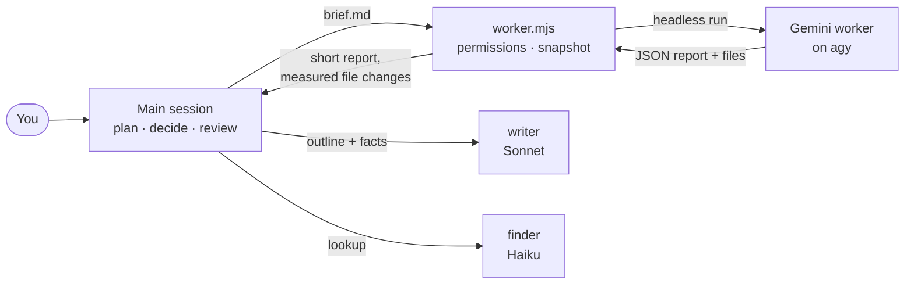

# Brain Dispatch

**English** | [简体中文](README.zh-CN.md)

A Claude Code plugin that keeps your main session as the brain and sends the legwork somewhere cheaper.

- **Brain**: your main Claude session. It plans, decides, reviews and writes the short final answer.
- **Worker**: a Gemini model (Gemini 4 Hydrogen by default) running headless on Google's Antigravity CLI (`agy`). It searches, extracts, crunches data, writes and runs scripts, and generates files.
- **Writer**: a Sonnet subagent for long drafts that need no new reasoning.
- **Finder**: a Haiku subagent for read-only lookups, used when the worker is unavailable.

The point is quota. Your strongest model spends its tokens on thinking and checking instead of reading forty files or typing out a 6000-word document.

## How it works



1. The brain writes a self-contained brief (goal, background, input, output, done-when, boundaries).
2. `worker.mjs` prepends a fixed protocol, generates a one-off permission profile for this single run, snapshots the writable directories and starts `agy` headless.
3. The worker does the job inside the directories it was given and answers with one JSON report that must match a schema.
4. The dispatcher snapshots the directories again and **measures** what was created, changed or deleted, then reconciles that with what the worker claims and with the writes recorded in the worker's event stream.
5. The brain gets a short report, spot-checks it and decides what to use.

## What makes it different

- **Permissions are enforced, and checked afterwards.** Each run gets explicit allow and deny rules, and every file the worker writes with its tools is checked against the writable directories once it finishes. Nothing uses `--dangerously-skip-permissions`.
- **File changes are measured.** The report's file list comes from a before/after comparison, so a mistyped path or an unreported edit shows up.
- **A fixed report format.** Status, summary, files, findings, verified, unverified, open. A reply that does not match the schema is rejected rather than trusted.
- **Honest failure.** Timeouts, missing login, quota, denied actions and files that do not reconcile each have their own exit code and message.
- **The brain stays in charge.** There is no automatic routing. The main session decides what to hand off, and the skill tells it when *not* to.

## Requirements

- [Claude Code](https://code.claude.com/docs) with plugin support
- Node.js 18 or later (no npm packages needed)
- [Antigravity CLI](https://antigravity.google/docs) (`agy`), installed and signed in, on a plan that includes the worker model

Without `agy` the writer and finder subagents still work; only the worker is unavailable.

## Install

In Claude Code:

```
/plugin marketplace add keienhrri-bit/brain-dispatch
/plugin install brain-dispatch@brain-dispatch
/brain-dispatch:setup
```

`/brain-dispatch:setup` checks Node and `agy`, writes `~/.brain-dispatch/config.json`, and runs one small read-only job to prove the worker answers.

## Use

After setup you mostly do nothing. A short note at session start tells the main session how the work is divided, and it loads the `brain-dispatch:dispatch` skill when a job is worth handing off. You can also ask in words:

> Dispatch this to the worker: go through `logs/` and give me a table of every timeout with file, line and timestamp.

> Have the worker write a script that merges these CSVs, run it, and report the row counts.

> I've checked the outline and numbers in `notes/`. Give it to the writer and save the handbook to `docs/handbook.md`.

### Access levels

| `--access` | The worker can | Typical job |
|---|---|---|
| `read` | Read files. No writes, no commands | Lookups, counting, independent solving |
| `write` (default) | Write to the working directory and any `--write-dir`. Protected and read-only directories are denied; a write anywhere else is caught after the run and the job is rejected. No commands | Extract tables, notes, conversions |
| `full` | `write`, plus run commands | A script has to actually run |

Never writable at any level: agent and credential directories under your home directory (`.claude`, `.codex`, `.gemini`, `.grok`, `.ssh`, `.aws`, `.gnupg`, `.kube`, `.config/gh`), the dispatcher's own state directory, anything in `protect` in the config, and every `--read-dir`. MCP servers and the browser are always off; `--web` allows web search and URL reads.

### What the brain sees (example)

```
WORKER timeouts | done | gemini-4-hydrogen-high | write | 142s | tokens 61,204
Summary: 37 timeouts in 5 log files; table written.
Files (measured by the dispatcher):
  + /work/out/timeouts.csv  4.1 KB  -- one row per timeout
Findings:
  1. 29 of 37 timeouts come from api-gateway (api-gateway.log:112-940)
Verified:
  1. Re-read 5 rows against the source lines
Unverified: none
Open: none
Full report: ~/.brain-dispatch/jobs/20261114-213005_timeouts/report.md
```

File lines: `+` created · `~` modified · `-` deleted · `!` reported but missing · `?` changed but not reported · `!!` a read-only directory was touched, or a file was written outside the writable directories. Two more sections appear when they apply: **Denied by the permission rules** lists the tool calls the rules refused, and at `full` access **Commands run** lists every command the worker ran.

Exit codes: `0` valid report · `2` bad arguments or directory rule violated · `3` rejected (no valid report, blocked, files that do not reconcile, a `!!` line) · `4` timeout, including a run that used up its time limit without a report · `5` backend missing, not signed in, or out of quota.

## Configuration

`~/.brain-dispatch/config.json`:

```json
{
  "worker": { "model": "gemini-4-hydrogen", "effort": "high", "timeoutMin": 20 },
  "protect": [],
  "proxy": null,
  "agy": null,
  "policyHook": true
}
```

| Key | Meaning |
|---|---|
| `worker.model`, `worker.effort` | Joined into the model id passed to `agy`, for example `gemini-4-hydrogen-high`. Any model `agy models` lists will do |
| `worker.timeoutMin` | Default time limit per job |
| `protect` | Extra directories no job may write to |
| `proxy` | Proxy URL for the backend process, if it does not pick up your system proxy |
| `agy` | Full path to the `agy` executable when it is not on `PATH` |
| `policyHook` | `false` turns off the note printed at session start |

Set `BRAIN_DISPATCH_HOME` to keep config, job files and the ledger somewhere other than `~/.brain-dispatch`.

## Use the dispatcher on its own

`worker.mjs` does not depend on Claude Code. Any agent or script that can run a command can use it:

```bash
node scripts/worker.mjs --name demo --task brief.md --workdir ./scratch --access write
node scripts/worker.mjs --name demo --task brief.md --workdir ./scratch --dry-run   # show the permission profile, run nothing
node scripts/doctor.mjs                                                             # check the environment
```

## Security notes

- **Writes outside the writable directories are caught, not prevented.** `agy` evaluates its rules as Deny > Ask > Allow and cannot express "only these directories are writable": a broad deny would also override the narrow allows, and in headless mode a directory no rule mentions is not blocked. So the dispatcher allows the writable directories, denies the protected and read-only ones, and afterwards reads the worker's event stream (`--output-format stream-json`). Any file its tools wrote elsewhere is listed with `!!` and the job is rejected with exit code 3. By then the file is already on disk; the report tells you where.
- **`full` access has no OS sandbox.** The audit above sees what the file tools write, not what a command writes, and a command can write wherever the process can. The report lists every command that ran, and read-only directories are still compared before and after the run. The dispatcher also blocks command patterns: deleting, downloading, `git push`/`reset`/`clean`/`restore`, system settings, global installs and starting other agents. Short names such as `rm` or `dd` only count where a command starts, so they do not trip on arguments or paths. That is a seat belt, not a cage. Use `full` on material you trust, in a working directory you can throw away or review with `git diff`.
- Every level can **read** the whole machine. Do not point the worker at material you would not send to the model provider. Briefs and the files the worker reads go to Google.
- Text inside the material is treated as content, not as instructions, by protocol. A protocol is not a guarantee. Review what comes back.
- The permission rule syntax belongs to `agy` and has changed between versions. Check with `--dry-run` after upgrading `agy`.

## Status

Version 0.2.0. Developed on Windows 11 with Node 24 and `agy` 1.5.9. The dispatcher is a Node port of a PowerShell script that has run real jobs. It ships with automated tests that run against a fake backend, and the permission rules, the command directory and the write audit have been checked against real `agy` runs. The code is written to be cross-platform, but macOS and Linux have not been exercised yet; reports and fixes are welcome.

Not included yet: a reviewer role on another vendor's CLI, a web-research role, and per-job cost accounting.

## Develop

```bash
git clone https://github.com/keienhrri-bit/brain-dispatch
claude --plugin-dir ./brain-dispatch     # load the plugin from the working tree
node --test                              # unit and end-to-end tests against a fake backend (run from the repo root)
claude plugin validate ./brain-dispatch
```

## Related work

- Anthropic, [How we built our multi-agent research system](https://www.anthropic.com/engineering/multi-agent-research-system): the orchestrator-worker pattern and what a good brief contains.
- [keli-wen/agy-staff](https://github.com/keli-wen/agy-staff) and [yuting0624/antigravity-for-claude-code](https://github.com/yuting0624/antigravity-for-claude-code): other ways to put `agy` behind Claude Code.

## License

[MIT](LICENSE)
