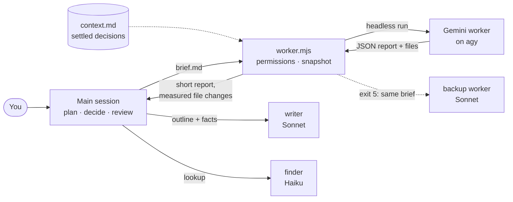

# Brain Dispatch

**English** | [简体中文](README.zh-CN.md)

Keep your most expensive Claude model for thinking. Brain Dispatch is a Claude Code plugin that makes the main session the brain, which plans, decides and reviews, and hands the bulk legwork to models that cost your Claude plan less, or nothing.

```
/plugin marketplace add keienhrri-bit/brain-dispatch
/plugin install brain-dispatch@brain-dispatch
```

That is enough for the Claude-only roles. To add the Gemini worker, which is the point of the plugin, run `/brain-dispatch:setup`.

## Roles

| Role | Runs on | Does | Cost to your Claude plan |
|---|---|---|---|
| **Brain** | Your main session, on whichever model you pick with `/model` | Plans, decides, reviews, writes the short final answer | Full |
| **Worker** | A Gemini model (Gemini 4 Hydrogen by default), headless on Google's Antigravity CLI (`agy`) | Bulk legwork: searching and extracting across many files, crunching data, writing and running scripts, generating files | None. It runs on your Antigravity plan |
| **Backup worker** | Sonnet subagent | The same jobs, from the same brief, when the worker is not installed, signed out or out of quota | Lower |
| **Writer** | Sonnet subagent | Long drafts from an outline and facts the brain has checked | Lower |
| **Finder** | Haiku subagent | Read-only lookups | Lowest |

The plugin checks the machine at session start. With `agy` present, bulk legwork goes to the Gemini worker. Without it, the same division of labor runs on Sonnet and Haiku, and nothing else has to be installed.

## How it works



1. The brain writes a self-contained brief (goal, background, input, output, done-when, boundaries).
2. `worker.mjs` prepends a fixed protocol and the shared context file if there is one, generates a one-off permission profile for this single run, snapshots the writable directories and starts `agy` headless.
3. The worker does the job inside the directories it was given and answers with one JSON report that must match a schema.
4. The dispatcher snapshots the directories again and **measures** what was created, changed or deleted, then reconciles that with what the worker claims and with the writes recorded in the worker's event stream.
5. The brain gets a short report, spot-checks it and decides what to use.

## What makes it different

- **Permissions are enforced, and checked afterwards.** Each run gets explicit allow and deny rules, and every file the worker writes with its tools is checked against the writable directories once it finishes. Nothing uses `--dangerously-skip-permissions`.
- **File changes are measured.** The report's file list comes from a before/after comparison, so a mistyped path or an unreported edit shows up.
- **A fixed report format.** Status, summary, files, findings, verified, unverified, open. A reply that does not match the schema is rejected rather than trusted, and what the worker did not check stays visible as its own field.
- **A failed dispatch costs no rewrite.** Timeouts, missing sign-in, quota, denied actions and files that do not reconcile each have their own exit code. When the worker is unavailable, the dispatcher names the subagent that takes the same brief file.
- **One more step costs a few lines.** `--follow-up` continues an earlier job in the same `agy` conversation. The worker keeps what it read, the brain writes a short note instead of a new brief, and the same permission rules and file audit apply.
- **One shared context file.** Settled decisions and conventions are written once by the brain and put in front of every job. The worker's file tools are denied writes to it, and a run during which it changed anyway is rejected.
- **Bounded continuation.** Two follow-ups per conversation by default, counted across sibling attempts as well as chains. An optional reported-token threshold stops further continuation before another backend call.
- **One owner for overlapping work.** Local leases reject concurrent writes to overlapping directories and concurrent continuation of the same conversation. Independent directories can still run in parallel.
- **Visible usage.** `node scripts/stats.mjs` summarizes captured jobs, failures, partial results, follow-ups and backend-reported tokens, keeping unknown usage separate from zero.
- **No git required.** The audit compares directory snapshots, so it works on a folder of documents or data as well as on a repository.
- **Small.** Two skills, three subagents, one hook, one dispatcher script. No npm packages, no MCP server, no background daemon.
- **The brain stays in charge.** There is no automatic routing. The main session decides what to hand off, and the skill tells it when *not* to.

## When it pays off

Handing work off is not free: the brain writes a brief, waits, and checks the result. On small self-contained tasks that overhead is larger than the saving. It pays on chunks: forty files to read, a table to build from raw material, a script to write and run, a long document to type out.

There is no controlled cost benchmark of this plugin yet, so this README does not claim a saving. Related projects show why measurement matters. [antigravity-for-claude-code](https://github.com/yuting0624/antigravity-for-claude-code) reports an eight-PR replay, two runs per cell: whole-task hand-off cost 0.58× per passing task under its registered price assumptions, while file-by-file delegation cost 1.33–1.68×. At its actual higher Gemini rate the overall saving disappeared. [agy-staff](https://github.com/keli-wen/agy-staff) reports one run per task/setup: Claude-side spend fell across its three benchmarks, but Codex-side spend increased on two, and median time rose. These are their experiments, not transferable guarantees about subscription quota.

The [coordination research and implementation review (Chinese)](docs/coordination-review.zh-CN.md) compares existing projects and six papers, explains the narrow scope, and separates measured behavior from open questions.

Subagents on Sonnet and Haiku still draw on your Claude plan, at a lower rate. Only the Gemini worker costs it nothing.

## Requirements

- [Claude Code](https://code.claude.com/docs) with plugin support
- Node.js 18 or later (no npm packages needed)
- Optional: the [Antigravity CLI](https://antigravity.google/docs/getting-started) (`agy`), installed and signed in, on a plan that includes the worker model

## Install

In Claude Code:

```
/plugin marketplace add keienhrri-bit/brain-dispatch
/plugin install brain-dispatch@brain-dispatch
/brain-dispatch:setup
```

`/brain-dispatch:setup` checks Node and `agy`, shows which roles this machine has, writes `~/.brain-dispatch/config.json`, and runs one small read-only job to prove the worker answers. If `agy` is not installed it shows Google's install command and leaves the decision to you.

## Use

After setup you mostly do nothing. A short note at session start tells the main session how the work is divided, and it loads the `brain-dispatch:dispatch` skill when a job is worth handing off. You can also ask in words:

> Dispatch this to the worker: go through `logs/` and give me a table of every timeout with file, line and timestamp.

> Have the worker write a script that merges these CSVs, run it, and report the row counts.

> I've checked the outline and numbers in `notes/`. Give it to the writer and save the handbook to `docs/handbook.md`.

### Shared context

When one piece of work needs several hand-offs, the brain keeps a single context file (goal, settled decisions, conventions, where things are, what is still open) and passes it to every job with `--context`. Background is written once instead of once per brief, and every job starts from the same decisions. Only the brain edits the file. Results move between roles as file paths, not as pasted text.

`meta.json` records `context_sha256` for the exact file bytes injected, plus `context_chars` and `prompt_chars`. A missing or invalid context file stops a follow-up; it is never silently discarded. Context is still sent on each call: a shared file is not shared model memory or a provider prompt-cache guarantee.

### Follow-ups

When a job comes back incomplete, or wrong in one place, the brain sends a follow-up instead of a new brief: `--follow-up <job>` resumes the same `agy` conversation with a short note. Directories, access level, model and context file come from the earlier job, and the run is audited like any other. If `agy` cannot find the conversation it starts a new one and still exits with 0, so the dispatcher compares conversation ids and rejects that run.

A follow-up saves the brain a brief and saves the worker a second pass over its material. It does not make the worker's run cheaper: the backend sends the earlier conversation again on every resumed call, and a similar project [measured](https://github.com/yuting0624/antigravity-for-claude-code/blob/master/skills/antigravity/SKILL.md) a resumed call costing more than a fresh one on a large corpus. Use it to fix or finish a job, not to start a new one.

Only an accepted `done` or `partial` job in the current `BRAIN_DISPATCH_HOME` can continue. The default `worker.maxFollowUps` is 2; selecting the original parent again does not reset that count. A rejected or unfinished attempt in that conversation requires reviewing its artifacts and starting a fresh, narrower job. `worker.maxReportedTokens`, when set, blocks another follow-up once the sum of captured `usage.total_tokens` reaches the threshold; unknown earlier usage also blocks it. This is a conservative preflight threshold, not a live per-call limit, billing estimate or subscription-quota cap. A call already in progress can exceed it, and cumulative backend counters may be counted more than once.

### Concurrent jobs

Every non-dry run holds a local lease through its file audit and metadata write. Jobs using the same state home cannot simultaneously write overlapping directories, write another job's declared read directory/context file, or resume the same conversation. Readers may coexist. Give independent workers separate directories or worktrees; the brain should also avoid editing a running worker's directories.

Conflicts exit with code 2 before starting `agy`; there is no retry loop or hidden queue. The lease registry lives in `$BRAIN_DISPATCH_HOME/active`. Normal completion releases it. After a forced kill, inspect the named dispatcher **and its backend child** before removing that specific orphaned lease; do not clear active records wholesale. A leftover `.registration` directory likewise requires checking running dispatchers. Leases coordinate this dispatcher only, within one local state home. Other programs, other state homes and remote hosts are outside their scope.

### Inspect usage

```bash
node scripts/stats.mjs
node scripts/stats.mjs --workdir ./scratch --json
```

This reads only completed `jobs/*/meta.json` records and does not launch a model, read prompt/event bodies, or create state. It includes rejected jobs with usage, distinguishes zero from unknown, and warns about invalid metadata. It excludes the brain's tokens and calls that left no metadata. Treat totals as backend-reported observations: they do not establish money or quota saved. Compare accepted task quality, brain usage, worker usage, repairs and elapsed time against a solo baseline before changing your routing policy.

### Access levels

| `--access` | The worker can | Typical job |
|---|---|---|
| `read` | Read files. No writes, no commands | Lookups, counting, independent solving |
| `write` (default) | Write to the working directory and any `--write-dir`. Protected and read-only directories are denied; a write anywhere else is caught after the run and the job is rejected. No commands | Extract tables, notes, conversions |
| `full` | `write`, plus run commands | A script has to actually run |

Never writable at any level: agent and credential directories under your home directory (`.claude`, `.codex`, `.gemini`, `.grok`, `.ssh`, `.aws`, `.gnupg`, `.kube`, `.config/gh`), the dispatcher's own state directory, anything in `protect` in the config, and every `--read-dir`. MCP servers and the browser are always off; `--web` allows web search and URL reads.

### What the brain sees (example)

```
WORKER timeouts | done | gemini-4-hydrogen-high | write | 142s | tokens 61,204
Summary: 37 timeouts in 5 log files; table written.
Files (measured by the dispatcher):
  + /work/out/timeouts.csv  4.1 KB  -- one row per timeout
Findings:
  1. 29 of 37 timeouts come from api-gateway (api-gateway.log:112-940)
Verified:
  1. Re-read 5 rows against the source lines
Unverified: none
Open: none
Full report: ~/.brain-dispatch/jobs/20261114-213005_timeouts/report.md
```

File lines: `+` created · `~` modified · `-` deleted · `!` reported but missing · `?` changed but not reported · `!!` a read-only directory was touched, a file was written outside the writable directories, or the shared context file was modified. Two more sections appear when they apply: **Denied by the permission rules** lists the tool calls the rules refused, and at `full` access **Commands run** lists every command the worker ran.

Exit codes: `0` accepted report (including `partial`; the brain still reviews quality) · `2` invalid arguments/context/history, an active-job conflict, or a continuation limit · `3` rejected (invalid/blocked report, failed backend, missing or unreported files, deleted files, a `!!` line, or a conversation mismatch) · `4` timeout · `5` backend unavailable; the output names the fallback. Rejection retains artifacts for inspection; it does not undo changes.

## Choosing the brain

The brain is whatever model your main session runs. Pick it with `/model`: the strongest model you have is the usual choice, because every decision and every check goes through it. The subagents are pinned to Sonnet and Haiku and do not follow that choice.

Built-in subagents such as Explore and general-purpose inherit the main session's model unless a cheaper one is passed, which is why the session note steers legwork to the roles above.

If you would rather run a cheaper main model, Claude Code's [advisor](https://code.claude.com/docs/en/advisor) pairs it with a stronger model at decision points. Brain Dispatch works the same under that setup.

## Configuration

`~/.brain-dispatch/config.json`:

```json
{
  "worker": { "model": "gemini-4-hydrogen", "effort": "high", "timeoutMin": 20, "maxFollowUps": 2, "maxReportedTokens": null },
  "protect": [],
  "proxy": null,
  "agy": null,
  "policyHook": true
}
```

| Key | Meaning |
|---|---|
| `worker.model`, `worker.effort` | Joined into the model id passed to `agy`, for example `gemini-4-hydrogen-high`. Any model `agy models` lists will do |
| `worker.timeoutMin` | Default time limit per job |
| `worker.maxFollowUps` | Nonnegative integer; maximum follow-up attempts per conversation (default 2, 0 disables continuation) |
| `worker.maxReportedTokens` | Optional positive integer; conservative reported-token preflight threshold for continuation, default `null` |
| `protect` | Extra directories no job may write to |
| `proxy` | Proxy URL for the backend process, if it does not pick up your system proxy |
| `agy` | Full path to the `agy` executable when it is not on `PATH` |
| `policyHook` | `false` turns off the note printed at session start |

Set `BRAIN_DISPATCH_HOME` to keep config, job files and the ledger somewhere other than `~/.brain-dispatch`.
Keep it outside the working, writable and read-only directories being audited; otherwise the dispatcher's own logs would invalidate its snapshots, so the run is refused before launch.

## Use the dispatcher on its own

`worker.mjs` does not depend on Claude Code. Any agent or script that can run a command can use it:

```bash
node scripts/worker.mjs --name demo --task brief.md --workdir ./scratch --access write
node scripts/worker.mjs --name demo --task brief.md --workdir ./scratch --context context.md
node scripts/worker.mjs --follow-up demo --name demo-fix --task note.md             # one more step in the same conversation
node scripts/worker.mjs --name demo --task brief.md --workdir ./scratch --dry-run   # show the permission profile, run nothing
node scripts/doctor.mjs                                                             # check the environment, list the roles
```

## Security notes

- **Writes outside the writable directories are caught, not prevented.** `agy` evaluates its rules as Deny > Ask > Allow and cannot express "only these directories are writable": a broad deny would also override the narrow allows, and in headless mode a directory no rule mentions is not blocked. So the dispatcher allows the writable directories, denies the protected and read-only ones, and afterwards reads the worker's event stream (`--output-format stream-json`). Any file its tools wrote elsewhere is listed with `!!` and the job is rejected with exit code 3. By then the file is already on disk; the report tells you where.
- **`full` access has no OS sandbox.** The audit above sees what the file tools write, not what a command writes, and a command can write wherever the process can. The report lists every command that ran, and read-only directories are still compared before and after the run. The dispatcher also blocks command patterns: deleting, downloading, `git push`/`reset`/`clean`/`restore`, system settings, global installs and starting other agents. Short names such as `rm` or `dd` only count where a command starts, so they do not trip on arguments or paths. That is a seat belt, not a cage. Use `full` on material you trust, in a working directory you can throw away or review with `git diff`.
- **The subagents are not covered by any of this.** The backup worker, writer and finder run under your Claude Code session's own permission settings. The dispatcher's rules and its file audit apply only to the Gemini worker.
- Every level can **read** the whole machine. Do not point the worker at material you would not send to the model provider. Briefs, the shared context file and the files the worker reads go to Google.
- Text inside the material is treated as content, not as instructions, by protocol. A protocol is not a guarantee. Review what comes back.
- The permission rule syntax belongs to `agy` and has changed between versions. Check with `--dry-run` after upgrading `agy`.

## Status and scope

Version 0.4.0. Developed on Windows 11 with Node 24 and `agy` 1.5.9. Tests cover a fake backend, coordination conflicts, failed hand-offs and usage inspection. CI runs the suite on Windows and Linux with Node 18 and 24. Real `agy` integration has been exercised on Windows; Linux/macOS backend behavior is not established by fake-backend CI.

Scope is deliberate: a Claude Code plugin plus a host-independent Antigravity dispatcher. Roles on other vendors' command-line tools are not planned. Not included yet: a controlled cost benchmark, provider billing/quota accounting, a distributed scheduler or automatic model routing.

## Develop

```bash
git clone https://github.com/keienhrri-bit/brain-dispatch
claude --plugin-dir ./brain-dispatch     # load the plugin from the working tree
node --test                              # unit and end-to-end tests against a fake backend (run from the repo root)
claude plugin validate ./brain-dispatch
```

## Related work

- Anthropic, [How we built our multi-agent research system](https://www.anthropic.com/engineering/multi-agent-research-system): the orchestrator-worker pattern and what a good brief contains.
- [keli-wen/agy-staff](https://github.com/keli-wen/agy-staff): `agy` as a staffer for five hosts (Claude Code, Codex and others), with background jobs, personas for research, review and implementation, and a published benchmark.
- [yuting0624/antigravity-for-claude-code](https://github.com/yuting0624/antigravity-for-claude-code): commands for delegation and for hand-offs verified by tests, cost-measurement tooling, a migration tool, and candid notes on where `agy` misbehaves.

Both are larger and do more. Brain Dispatch is the small one. Its focus is a permission profile per run with no permission skipping, a file audit that needs no git, and Claude-only roles that carry on when `agy` is absent.

## License

[MIT](LICENSE)
