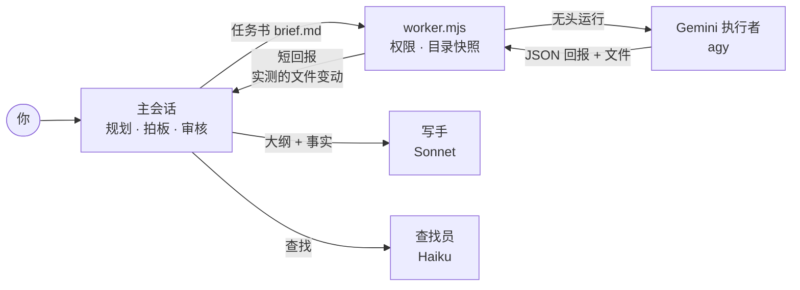

# Brain Dispatch

[English](README.md) | **简体中文**

一个 Claude Code 插件：主会话只当大脑，跑腿的活交给更便宜的模型。

- **大脑**：你的 Claude 主会话。负责规划、拍板、审核，以及写简短的最终答复。
- **执行者（Worker）**：跑在 Google Antigravity CLI（`agy`）上的 Gemini 模型，默认是 Gemini 4 Hydrogen，以无头方式运行。负责查找、抽取、处理数据、写脚本并运行、批量生成文件。
- **写手（Writer）**：Sonnet 子代理，写不需要新推理的长稿。
- **查找员（Finder）**：Haiku 子代理，只读查找，执行者用不了时顶上。

目的只有一个：省额度。最强的模型把 token 花在思考和核对上，而不是花在通读四十个文件、敲出六千字文档上。

## 工作方式



1. 大脑写一份自成一体的任务书：目标、背景、输入、产出、完成标准、边界。
2. `worker.mjs` 在任务书前面贴上固定协议，为这一次运行生成一次性的权限配置，给可写目录拍快照，然后无头启动 `agy`。
3. 执行者在给定的目录里把活做完，交回一份必须符合 Schema 的 JSON 回报。
4. 派单脚本再拍一次快照，**实测**新建、改动、删除了哪些文件，并和执行者自己报的对账。
5. 大脑拿到短回报，抽查之后决定用哪些。

## 和同类做法的区别

- **权限靠强制，不靠自觉。** 每次运行都有明确的放行和拒绝规则，从不使用 `--dangerously-skip-permissions`。
- **文件变动是实测的。** 回报里的文件清单来自运行前后的目录对比，路径抄错、改了没报都会显出来。
- **回报格式固定。** 状态、结论、文件、发现、已核对、未核对、待定。不符合 Schema 的回复直接判不合格，不拿来用。
- **失败如实报告。** 超时、未登录、额度用完、越权、对账不上，各有各的退出码和说明。
- **大脑始终做主。** 没有自动路由。交不交出去由主会话判断，技能里也写明了哪些活**不该**交。

## 需要什么

- 支持插件的 [Claude Code](https://code.claude.com/docs)
- Node.js 18 或更高版本（不需要任何 npm 包）
- 已安装并登录的 [Antigravity CLI](https://antigravity.google/docs)（`agy`），所用套餐包含执行者模型

没有 `agy` 时，写手和查找员两个子代理照常可用，只是执行者用不了。

## 安装

在 Claude Code 里：

```
/plugin marketplace add keienhrri-bit/brain-dispatch
/plugin install brain-dispatch@brain-dispatch
/brain-dispatch:setup
```

`/brain-dispatch:setup` 会检查 Node 和 `agy`，写入 `~/.brain-dispatch/config.json`，再跑一个很小的只读任务，确认执行者能回话。

## 使用

装好之后基本不用管。会话开始时有一段简短说明告诉主会话怎么分工，遇到值得交出去的活，它会自己加载 `brain-dispatch:dispatch` 技能。你也可以直接说：

> 把这件事派给执行者：翻一遍 `logs/`，把每一次超时列成表，带文件、行号和时间。

> 让执行者写个脚本把这几份 CSV 合并，跑一遍，报告行数。

> `notes/` 里的大纲和数字我都核过了，交给写手，把手册写到 `docs/handbook.md`。

### 权限档

| `--access` | 执行者能做什么 | 典型的活 |
|---|---|---|
| `read` | 读文件。不能写，不能跑命令 | 查找、计数、独立解题 |
| `write`（默认） | 在工作目录和 `--write-dir` 里建文件、改文件。不能跑命令 | 摘录表、笔记、格式转换 |
| `full` | 在 `write` 之上还能跑命令 | 确实要把脚本跑起来 |

任何档都不能写的目录：主目录下各个 agent 和凭据目录（`.claude`、`.codex`、`.gemini`、`.grok`、`.ssh`、`.aws`、`.gnupg`、`.kube`、`.config/gh`）、派单脚本自己的状态目录、配置里 `protect` 列的目录，以及每一个 `--read-dir`。MCP 和浏览器始终关闭；加 `--web` 才能联网搜索和读网页。

### 大脑看到的回报（示例）

```
WORKER timeouts | done | gemini-4-hydrogen-high | write | 142s | tokens 61,204
Summary: 37 timeouts in 5 log files; table written.
Files (measured by the dispatcher):
  + /work/out/timeouts.csv  4.1 KB  -- one row per timeout
Findings:
  1. 29 of 37 timeouts come from api-gateway (api-gateway.log:112-940)
Verified:
  1. Re-read 5 rows against the source lines
Unverified: none
Open: none
Full report: ~/.brain-dispatch/jobs/20261114-213005_timeouts/report.md
```

退出码：`0` 回报有效 · `2` 参数或目录规则不过 · `3` 不合格 · `4` 超时 · `5` 后端没装、没登录或额度用完。

## 配置

`~/.brain-dispatch/config.json`：

```json
{
  "worker": { "model": "gemini-4-hydrogen", "effort": "high", "timeoutMin": 20 },
  "protect": [],
  "proxy": null,
  "agy": null,
  "policyHook": true
}
```

| 键 | 含义 |
|---|---|
| `worker.model`、`worker.effort` | 拼成传给 `agy` 的模型名，例如 `gemini-4-hydrogen-high`。`agy models` 列出的模型都可以用 |
| `worker.timeoutMin` | 每一单的默认时限（分钟） |
| `protect` | 额外的、任何任务都不能写的目录 |
| `proxy` | 后端进程用的代理地址。后端没有自动走系统代理时填 |
| `agy` | `agy` 不在 `PATH` 里时，填它的完整路径 |
| `policyHook` | 设为 `false` 关闭会话开始时的那段说明 |

想把配置、任务文件和台账放到别处，设置环境变量 `BRAIN_DISPATCH_HOME`。

## 单独使用派单脚本

`worker.mjs` 不依赖 Claude Code。任何能运行命令的 agent 或脚本都能用它：

```bash
node scripts/worker.mjs --name demo --task brief.md --workdir ./scratch --access write
node scripts/worker.mjs --name demo --task brief.md --workdir ./scratch --dry-run   # 只看权限配置，不运行
node scripts/doctor.mjs                                                             # 环境自检
```

## 安全说明

- **`full` 档没有系统级沙箱。** 文件工具受目录规则限制，但命令本身能写到进程有权限的任何地方。派单脚本只拦命令模式：删除、联网下载、`git push`/`reset`/`clean`、系统设置、全局安装、再起别的 agent。这是安全带，不是笼子。`full` 只用在你信得过的材料上，工作目录要么可以随手丢掉，要么能用 `git diff` 审。
- 每一档都能**读**整台机器。不愿意发给模型提供方的材料，不要让执行者去碰。任务书和它读到的文件会发给 Google。
- 协议规定材料里的文字只算内容、不算指令，但协议不是保证。交回来的东西要审。
- 权限规则的写法是 `agy` 的，不同版本之间变过。升级 `agy` 之后先用 `--dry-run` 看一眼。

## 现状

版本 0.1.0。在 Windows 11、Node 24、`agy` 1.5.9 上开发。派单脚本是从一份跑过真实任务的 PowerShell 脚本移植成 Node 版的，附带 29 项用假后端运行的自动测试。代码按跨平台写，但 macOS 和 Linux 还没有实际跑过，欢迎反馈和修正。

暂时没有的：用别家命令行工具做审稿的角色、联网调研的角色、按单统计费用。

## 开发

```bash
git clone https://github.com/keienhrri-bit/brain-dispatch
claude --plugin-dir ./brain-dispatch     # 直接从工作目录加载插件
node --test                              # 用假后端跑单元测试和端到端测试（在仓库根目录运行）
claude plugin validate ./brain-dispatch
```

## 相关工作

- Anthropic：[How we built our multi-agent research system](https://www.anthropic.com/engineering/multi-agent-research-system)。编排者加执行者的模式，以及一份好的任务书该有什么。
- [keli-wen/agy-staff](https://github.com/keli-wen/agy-staff)、[yuting0624/antigravity-for-claude-code](https://github.com/yuting0624/antigravity-for-claude-code)：把 `agy` 接到 Claude Code 后面的另外两种做法。

## 许可证

[MIT](LICENSE)
