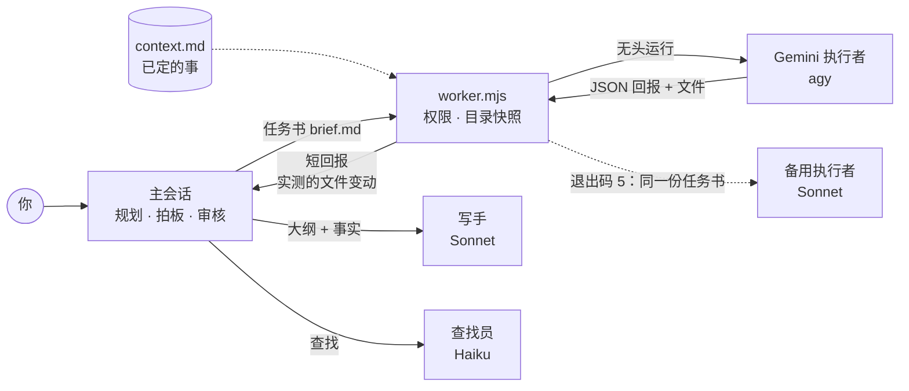

# Brain Dispatch

[English](README.md) | **简体中文**

把最贵的 Claude 模型留给思考。Brain Dispatch 是一个 Claude Code 插件：主会话只当大脑，负责规划、拍板、审核；成批的跑腿活交给更省额度、甚至不占 Claude 额度的模型。

```
/plugin marketplace add keienhrri-bit/brain-dispatch
/plugin install brain-dispatch@brain-dispatch
```

只用 Claude 自己的几个角色，装到这里就够了。要接上 Gemini 执行者（这才是这个插件的用处），再运行 `/brain-dispatch:setup`。

## 角色

| 角色 | 跑在哪 | 做什么 | 占 Claude 额度 |
|---|---|---|---|
| **大脑** | 你的主会话，模型用 `/model` 选 | 规划、拍板、审核，写简短的最终答复 | 全价 |
| **执行者（Worker）** | Google Antigravity CLI（`agy`）上的 Gemini 模型，默认 Gemini 4 Hydrogen，无头运行 | 成批的跑腿活：跨很多文件查找和抽取、处理数据、写脚本并运行、批量生成文件 | 不占，走你的 Antigravity 套餐 |
| **备用执行者（Backup worker）** | Sonnet 子代理 | 执行者没装、没登录或额度用完时，拿同一份任务书做同样的活 | 较低 |
| **写手（Writer）** | Sonnet 子代理 | 按大脑核过的大纲和事实写长稿 | 较低 |
| **查找员（Finder）** | Haiku 子代理 | 只读查找 | 最低 |

插件在会话开始时看一眼这台机器。有 `agy`，成批的活交给 Gemini 执行者；没有，同样的分工就跑在 Sonnet 和 Haiku 上，不用再装别的东西。

## 工作方式



1. 大脑写一份自成一体的任务书：目标、背景、输入、产出、完成标准、边界。
2. `worker.mjs` 在任务书前面贴上固定协议，有共享背景文件的话也一并贴上；为这一次运行生成一次性的权限配置，给可写目录拍快照，然后无头启动 `agy`。
3. 执行者在给定的目录里把活做完，交回一份必须符合 Schema 的 JSON 回报。
4. 派单脚本再拍一次快照，**实测**新建、改动、删除了哪些文件，再和执行者自己报的、以及它事件流里记下的写入对账。
5. 大脑拿到短回报，抽查之后决定用哪些。

## 和同类做法的区别

- **权限靠强制，事后还要查。** 每次运行都有明确的放行和拒绝规则；跑完之后，执行者用文件工具写的每一个文件都要和可写目录比对。从不使用 `--dangerously-skip-permissions`。
- **文件变动是实测的。** 回报里的文件清单来自运行前后的目录对比，路径抄错、改了没报都会显出来。
- **回报格式固定。** 状态、结论、文件、发现、已核对、未核对、待定。不符合 Schema 的回复直接判不合格，不拿来用；执行者没核对的东西单列一栏，不会混进结论里。
- **派单失败不用重写任务书。** 超时、未登录、额度用完、越权、对账不上，各有各的退出码。执行者用不了时，派单脚本会直接说明同一份任务书该交给哪个子代理。
- **多做一步只要几行。** `--follow-up` 在同一个 `agy` 对话里接着上一单继续。执行者读过的东西还在，大脑写几行补充说明就行，不用重写任务书；权限规则和文件审计照旧。
- **一份共享背景文件。** 已定的决定和约定由大脑写一次，贴在每一单前面。执行者的文件工具写不了它；运行期间它要是还是变了，那一单判不合格。
- **追加有硬上限。** 默认每个对话最多追加两次，从原任务另开分支追加也算次数；可选的已报告 token 阈值在下一次调用前检查。
- **冲突任务只有一个写入者。** 本地占用记录阻止两个任务同时写重叠目录，或同时续办同一个对话。互不影响的目录仍可并行。
- **看得见用量。** `node scripts/stats.mjs` 汇总已记录的任务、失败、部分完成、追加次数和后端 token，把未知用量与零分开。
- **不依赖 git。** 审计靠对比目录快照，所以一个放文档或数据的普通文件夹也能用，不限于代码仓库。
- **小。** 两个技能、三个子代理、一个钩子、一个派单脚本。不需要 npm 包，没有 MCP 服务器，没有后台常驻进程。
- **大脑始终做主。** 没有自动路由。交不交出去由主会话判断，技能里也写明了哪些活**不该**交。

## 什么时候划算

把活交出去不是白来的：大脑要写任务书、等结果、再核一遍。小而独立的任务，这点开销比省下来的还多。划算的是成块的活：四十个文件要读、要从原始材料整理出一张表、要写个脚本跑出结果、要敲出一份长文档。

这个插件还没有受控的成本对比实验，因此不宣称节省多少。[antigravity-for-claude-code](https://github.com/yuting0624/antigravity-for-claude-code) 公布了八个 PR 的重放实验，每格两次：在登记的计价假设下，整项交付每个通过任务的成本为单模型的 0.58 倍，逐文件派单却是 1.33–1.68 倍；按作者实际更高的 Gemini 费率，总体节省又消失了。[agy-staff](https://github.com/keli-wen/agy-staff) 每题每种设置只跑一次的基线中，Claude 侧三组基准都省了，但 Codex 侧两组变贵，等待时间也变长。这些是它们的实验，不是本项目或你的订阅额度的保证。

[本次协调架构研究与实现审查](docs/coordination-review.zh-CN.md) 比较了现有项目和六篇论文，说明哪些值得借鉴、哪些不必加入，以及哪些问题仍待测量。

Sonnet 和 Haiku 子代理仍然占你的 Claude 额度，只是费率低。只有 Gemini 执行者一点都不占。

## 需要什么

- 支持插件的 [Claude Code](https://code.claude.com/docs)
- Node.js 18 或更高版本（不需要任何 npm 包）
- 可选：已安装并登录的 [Antigravity CLI](https://antigravity.google/docs/getting-started)（`agy`），所用套餐包含执行者模型

## 安装

在 Claude Code 里：

```
/plugin marketplace add keienhrri-bit/brain-dispatch
/plugin install brain-dispatch@brain-dispatch
/brain-dispatch:setup
```

`/brain-dispatch:setup` 会检查 Node 和 `agy`，列出这台机器上有哪些角色，写入 `~/.brain-dispatch/config.json`，再跑一个很小的只读任务，确认执行者能回话。没装 `agy` 时它会给出 Google 的安装命令，装不装由你决定。

## 使用

装好之后基本不用管。会话开始时有一段简短说明告诉主会话怎么分工，遇到值得交出去的活，它会自己加载 `brain-dispatch:dispatch` 技能。你也可以直接说：

> 把这件事派给执行者：翻一遍 `logs/`，把每一次超时列成表，带文件、行号和时间。

> 让执行者写个脚本把这几份 CSV 合并，跑一遍，报告行数。

> `notes/` 里的大纲和数字我都核过了，交给写手，把手册写到 `docs/handbook.md`。

### 共享背景

一件事要派好几单时，大脑维护一份背景文件（目标、已定的决定、约定、东西在哪、还没定的问题），每一单都用 `--context` 带上。背景只写一次，不用每份任务书重讲一遍，每一单也都从同一套决定出发。这份文件只有大脑能改。各角色之间传结果，传的是文件路径，不是贴过去的正文。

每单的 `meta.json` 记录实际注入文件字节的 `context_sha256`，以及 `context_chars`、`prompt_chars`。背景文件丢失或无效时，追加会停止，不再静默丢掉背景。每次仍会发送背景正文：共享文件并不等于共享模型内部记忆，也不保证命中提供方缓存。

### 追加一步

一单交回来没做完，或者有一处做错了，大脑不用重写任务书，发一份补充说明就行：`--follow-up <任务名>` 接着同一个 `agy` 对话继续。目录、权限档、模型和背景文件都沿用上一单，审计和别的单一样。`agy` 找不到那个对话时会另开一个新对话，退出码照样是 0，所以派单脚本会核对对话 ID，对不上的那一单判不合格。

追加省的是大脑重写一份任务书，以及执行者把材料再翻一遍。它并不让执行者这一趟更便宜：每次续跑，后端都要把之前的对话重新发给模型，有同类项目[实测过](https://github.com/yuting0624/antigravity-for-claude-code/blob/master/skills/antigravity/SKILL.md)，材料量大时续跑比新开一单还贵。所以它用来补做和改错，不用来开新任务。

只允许继续当前 `BRAIN_DISPATCH_HOME` 内已验收的 `done` 或 `partial` 任务。默认 `worker.maxFollowUps=2`，重新选择最初那单也不会清零。该对话已有拒收或未完成的调用时，先审核残留文件，再开更小的新任务。可选的 `worker.maxReportedTokens` 在下一次追加前检查累计的 `usage.total_tokens`，达到阈值或有未知用量就停止。它是保守的调用前阈值，不是单次实时限额、费用估算或订阅额度上限；正在执行的一单仍可能超过阈值，后端若返回累计计数也可能被重复累计。

### 并行时怎样协调

任务从启动前到文件审核、元数据写完期间都持有本地占用记录。共享一个状态目录的任务，不能同时写重叠目录、写另一单声明的只读目录或背景文件，也不能同时续办同一个对话；多个只读任务可以共存。独立执行者使用独立目录或 worktree，大脑也应等执行者结束后再改它的目录。

发现冲突会在调用 `agy` 前以退出码 2 停止，没有自动重试或隐藏队列。占用记录位于 `$BRAIN_DISPATCH_HOME/active`，正常结束自动释放。强制终止后若留下记录，先确认指定派单进程及其后端子进程均已结束，再删除那一个遗留记录，不要整批清空。`.registration` 若遗留也先检查进程。这个机制只协调同一台机器、同一状态目录内的本调度器，不能锁住其他编辑器、其他状态目录或远端主机。

### 查看用量

```bash
node scripts/stats.mjs
node scripts/stats.mjs --workdir ./scratch --json
```

只读取已完成的 `jobs/*/meta.json`，不启动模型、不读完整提示词或事件正文、不创建状态目录。失败任务有用量也计入，零与未知分开，损坏记录给出提示。主脑消耗、没有留下元数据的调用不在其中。它回答“记录到了什么”，不能单独证明“省了多少”：决定怎么派单之前，要把验收质量、主脑用量、执行者用量、返工和总耗时与单模型方案一起比较。

### 权限档

| `--access` | 执行者能做什么 | 典型的活 |
|---|---|---|
| `read` | 读文件。不能写，不能跑命令 | 查找、计数、独立解题 |
| `write`（默认） | 写工作目录和 `--write-dir`。保护目录和只读目录被拒；写到其他地方，跑完会被查出来，整单判不合格。不能跑命令 | 摘录表、笔记、格式转换 |
| `full` | 在 `write` 之上还能跑命令 | 确实要把脚本跑起来 |

任何档都不能写的目录：主目录下各个 agent 和凭据目录（`.claude`、`.codex`、`.gemini`、`.grok`、`.ssh`、`.aws`、`.gnupg`、`.kube`、`.config/gh`）、派单脚本自己的状态目录、配置里 `protect` 列的目录，以及每一个 `--read-dir`。MCP 和浏览器始终关闭；加 `--web` 才能联网搜索和读网页。

### 大脑看到的回报（示例）

```
WORKER timeouts | done | gemini-4-hydrogen-high | write | 142s | tokens 61,204
Summary: 37 timeouts in 5 log files; table written.
Files (measured by the dispatcher):
  + /work/out/timeouts.csv  4.1 KB  -- one row per timeout
Findings:
  1. 29 of 37 timeouts come from api-gateway (api-gateway.log:112-940)
Verified:
  1. Re-read 5 rows against the source lines
Unverified: none
Open: none
Full report: ~/.brain-dispatch/jobs/20261114-213005_timeouts/report.md
```

文件行的记号：`+` 新建 · `~` 改动 · `-` 删除 · `!` 报了但不存在 · `?` 改了没报 · `!!` 碰了只读目录、写到了可写目录以外，或者改了共享背景文件。另有两节在用得上时出现：**Denied by the permission rules** 列出被权限规则拒掉的工具调用；`full` 档的 **Commands run** 列出执行者跑过的每一条命令。

退出码：`0` 回报通过结构和文件验收（也可能是 `partial`，质量仍由大脑审核）· `2` 参数、背景或历史无效，任务占用冲突，或追加达到上限 · `3` 不合格（回报无效、受阻、后端失败、报了但不存在或漏报的文件、删文件、出现 `!!` 行、对话 ID 对不上）· `4` 超时 · `5` 后端不可用，输出会说明备用方案。拒收会保留产物供检查，不自动撤销改动。

## 大脑用哪个模型

大脑就是你主会话在用的模型，用 `/model` 选。一般选手头最强的那个，因为每一个决定、每一次核对都经过它。几个子代理固定用 Sonnet 和 Haiku，不跟着主会话的模型走。

Claude Code 内置的 Explore、general-purpose 这类子代理，不另外指定便宜模型的话会沿用主会话的模型，所以会话开始的那段说明会把跑腿的活引到上面这几个角色。

如果你更想让主会话用便宜一些的模型，Claude Code 的[顾问（advisor）](https://code.claude.com/docs/en/advisor)可以给它配一个更强的模型，只在关键处出主意。Brain Dispatch 在那种配置下用法不变。

## 配置

`~/.brain-dispatch/config.json`：

```json
{
  "worker": { "model": "gemini-4-hydrogen", "effort": "high", "timeoutMin": 20, "maxFollowUps": 2, "maxReportedTokens": null },
  "protect": [],
  "proxy": null,
  "agy": null,
  "policyHook": true
}
```

| 键 | 含义 |
|---|---|
| `worker.model`、`worker.effort` | 拼成传给 `agy` 的模型名，例如 `gemini-4-hydrogen-high`。`agy models` 列出的模型都可以用 |
| `worker.timeoutMin` | 每一单的默认时限（分钟） |
| `worker.maxFollowUps` | 每个对话最多追加几次，非负整数；默认 2，设 0 禁止追加 |
| `worker.maxReportedTokens` | 可选正整数；追加前检查的已报告 token 阈值，默认 `null` |
| `protect` | 额外的、任何任务都不能写的目录 |
| `proxy` | 后端进程用的代理地址。后端没有自动走系统代理时填 |
| `agy` | `agy` 不在 `PATH` 里时，填它的完整路径 |
| `policyHook` | 设为 `false` 关闭会话开始时的那段说明 |

想把配置、任务文件和台账放到别处，设置环境变量 `BRAIN_DISPATCH_HOME`。
状态目录必须放在工作目录、额外可写目录和声明的只读目录之外；否则调度器自己写的日志会影响快照，因此会在调用前拒绝这种配置。

## 单独使用派单脚本

`worker.mjs` 不依赖 Claude Code。任何能运行命令的 agent 或脚本都能用它：

```bash
node scripts/worker.mjs --name demo --task brief.md --workdir ./scratch --access write
node scripts/worker.mjs --name demo --task brief.md --workdir ./scratch --context context.md
node scripts/worker.mjs --follow-up demo --name demo-fix --task note.md             # 在同一个对话里追加一步
node scripts/worker.mjs --name demo --task brief.md --workdir ./scratch --dry-run   # 只看权限配置，不运行
node scripts/doctor.mjs                                                             # 环境自检，列出角色
```

## 安全说明

- **写到可写目录以外，是事后查出，不是事前拦住。** `agy` 的规则按 Deny > Ask > Allow 生效，表达不了“只有这几个目录可写”：宽泛的 deny 会连窄的 allow 一起压掉；无头模式下，没有任何规则提到的目录也照样能写。所以派单脚本放行可写目录、拒绝保护目录和只读目录，跑完再读执行者的事件流（`--output-format stream-json`）：它的工具写到别处的文件都用 `!!` 列出来，整单按退出码 3 判不合格。这时文件已经落盘，回报会告诉你在哪。
- **`full` 档没有系统级沙箱。** 上面的审计只看得到文件工具写了什么，看不到命令写了什么，而命令能写到进程有权限的任何地方。回报会列出跑过的每一条命令，只读目录照旧做前后对比。派单脚本另外拦命令模式：删除、联网下载、`git push`/`reset`/`clean`/`restore`、系统设置、全局安装、再起别的 agent。`rm`、`dd` 这类短命令名只在命令开头的位置才算，不会因为参数或路径里有这几个字母被误拦。这是安全带，不是笼子。`full` 只用在你信得过的材料上，工作目录要么可以随手丢掉，要么能用 `git diff` 审。
- **子代理不在上面这些保护之内。** 备用执行者、写手、查找员按你 Claude Code 会话自己的权限设置运行。派单脚本的规则和文件审计只管 Gemini 执行者。
- 每一档都能**读**整台机器。不愿意发给模型提供方的材料，不要让执行者去碰。任务书、共享背景文件和它读到的文件会发给 Google。
- 协议规定材料里的文字只算内容、不算指令，但协议不是保证。交回来的东西要审。
- 权限规则的写法是 `agy` 的，不同版本之间变过。升级 `agy` 之后先用 `--dry-run` 看一眼。

## 现状和范围

版本 0.4.0。在 Windows 11、Node 24、`agy` 1.5.9 上开发。自动测试覆盖假后端、并发冲突、失败交接和用量统计；CI 在 Windows、Linux 的 Node 18 和 24 上运行。真实 `agy` 集成在 Windows 上验收；假后端 CI 不代表 Linux/macOS 的真实后端已经测过。

范围是有意收窄的：Claude Code 插件加可独立调用的 Antigravity 调度器，不扩展别家 CLI 执行者。暂时没有的：受控成本对比、提供方账单和订阅额度统计、分布式调度器、自动模型路由。

## 开发

```bash
git clone https://github.com/keienhrri-bit/brain-dispatch
claude --plugin-dir ./brain-dispatch     # 直接从工作目录加载插件
node --test                              # 用假后端跑单元测试和端到端测试（在仓库根目录运行）
claude plugin validate ./brain-dispatch
```

## 相关工作

- Anthropic：[How we built our multi-agent research system](https://www.anthropic.com/engineering/multi-agent-research-system)。编排者加执行者的模式，以及一份好的任务书该有什么。
- [keli-wen/agy-staff](https://github.com/keli-wen/agy-staff)：让 `agy` 给五种宿主（Claude Code、Codex 等）当帮手，有后台任务、调研／评审／实现几种角色，还有公开的基准测试。
- [yuting0624/antigravity-for-claude-code](https://github.com/yuting0624/antigravity-for-claude-code)：有委派命令和用测试验收的整包交接、花费度量工具、迁移工具，文档里把 `agy` 出过的毛病写得很坦白。

这两个项目都更大，功能也更多。Brain Dispatch 是小的那个，专注三件事：每一单一份权限配置、从不跳过权限检查；文件审计不依赖 git；没有 `agy` 时，靠 Claude 自家的角色照样能干活。

## 许可证

[MIT](LICENSE)
