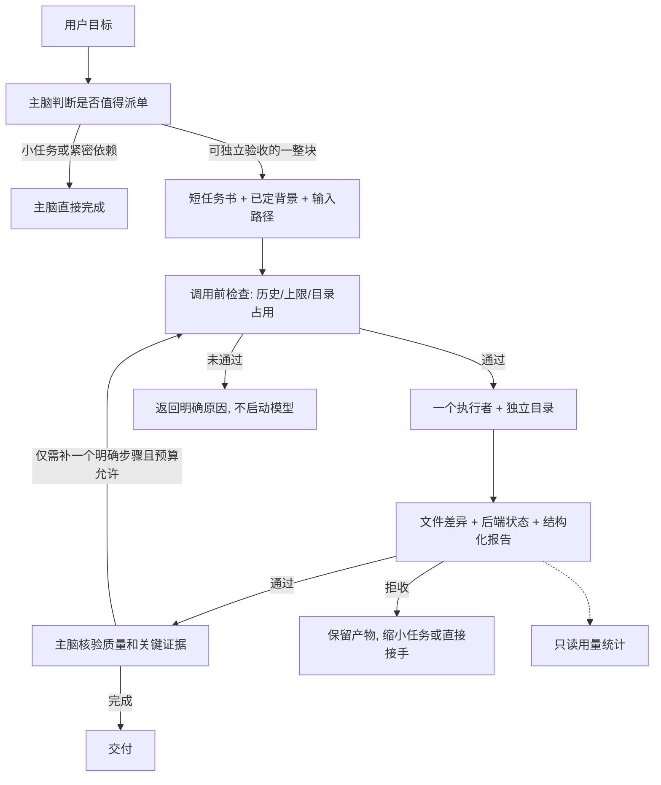

# Brain Dispatch：协调架构研究与实现审查

审查日期：2026-11-15。代码基线：`f7000ce`（0.3.0）。本文区分原项目已实现的能力、外部公开证据、本次改动和仍待验证的假设。它不是“全网没有替代品”的证明，也不是节省额度的广告。

## 结论：保留一个主脑，先把交接做可靠

主脑负责判断、执行者承担整块工作，这个架构已经有相当接近的开源实现。继续把 Brain Dispatch 扩成通用多 Agent 框架，收益不明确；更合适的方向是一个小而可检查的本地调度器：任务有清楚边界，产物落盘，续办有上限，冲突任务有占用记录，失败不伪装成成功，用量口径说清楚。

共享上下文也需要拆开理解。共享一个文件，解决的是“大家依据同一版已定事实”；它不意味着不同提供方共享模型内部状态，也不意味着这份背景不再计费。同会话续办能少写一次任务书、少做一次检索，但历史可能仍被后端重发。只有把主脑、执行者、历史重放、审核和返工合起来测，才能判断是否省钱或省订阅额度。

## 已有系统：哪些直接用，哪些只借鉴

以下依据项目自己的 README、官方文档和论文，不以星数作为效果证据，也没有在本轮完整部署这些第三方系统。

| 系统 | 已有能力与证据 | 对本项目的判断 |
|---|---|---|
| [agy-staff](https://github.com/keli-wen/agy-staff) | 多种宿主的 agy 执行者、第二主脑、后台任务和公开基线；默认执行权限较宽，可选限制 | 如果核心需求是 Claude/Codex 等多宿主接入，应优先评估直接使用它，避免重做适配层；借鉴整块派单与少唤醒主脑 |
| [antigravity-for-claude-code](https://github.com/yuting0624/antigravity-for-claude-code) | 委派、整项交接、测试验收、成本观测和迁移；README 明确原生 Windows 无头运行的适配限制 | 借鉴完整任务交付、受控返工和成本实验；不用为了同类功能重写全部工具链 |
| [LangGraph persistence](https://docs.langchain.com/oss/python/langgraph/persistence) | 线程检查点、恢复，以及跨线程长期存储；持久状态与消息上下文分开 | 长时间、多阶段、需要恢复的工作流可直接用；当前一个本地 CLI 执行者，不为状态文件再引入图运行时和存储服务 |
| [Microsoft Agent Framework](https://learn.microsoft.com/en-us/agent-framework/overview/) | Agent、显式工作流、会话状态、上下文提供者与多方集成 | 需要多提供方应用和复杂流程时优先评估；能力多不等于自动节省上下文 |
| [A2A](https://a2a-protocol.org/latest/topics/what-is-a2a/) | 跨框架 Agent 的发现、任务交换和互操作 | 跨机器服务真正需要互通时再接；它不替主脑判断哪个任务值得派，也不替提供方共享推理状态 |
| [MCP](https://modelcontextprotocol.io/docs/learn/architecture) | 模型应用与工具、资源的上下文交换协议 | 需要外部资料或工具接入时直接使用；官方明确协议不规定应用如何使用模型和管理上下文，不应把“有 MCP”当作共享记忆已解决 |

与本项目最接近的两套实现已经证明“别人做过”：没有必要再宣称“大脑—执行者”是一种新架构。Brain Dispatch 可以保留的具体价值，是原生 Windows 上可独立使用、无 npm 依赖、文件审核不要求 Git、失败和权限边界能检查。是否长期独立维护，仍应与直接采用上游的维护成本比较。

同类项目的成本数字也要带条件。antigravity-for-claude-code 的八个 PR 重放、每格两次实验，登记的价格表下整项交付每个通过任务约为单模型的 0.58 倍，逐文件派单却为 1.33–1.68 倍；换成作者实际更高的 Gemini 单价，总体节省消失。agy-staff 每题每种设置一次的基线中，Claude 侧三组下降，Codex 侧两组上涨；作者把频繁轮询造成的主脑上下文重复消费列为原因。这些不是我们已经复现的结果，也不能直接转成某个订阅的配额百分比。[前者原始说明](https://github.com/yuting0624/antigravity-for-claude-code)、[后者原始说明](https://github.com/keli-wen/agy-staff)。

## 论文给出的方向与适用限制

| 论文与版本日期 | 对协调问题的启示 | 不能据此声称什么 |
|---|---|---|
| [Why Do Multi-Agent LLM Systems Fail?](https://arxiv.org/abs/2503.13657)，2025-03 初稿，2025-10 v3 | MAST 将 14 类失败归入系统设计、Agent 间不一致、任务验证；交接和验收本身需要工程约束 | 不表示换一个更强的模型就消灭这些失败，也不保证某套框架实现了正确验收 |
| [Cut the Crap / AgentPrune](https://arxiv.org/abs/2410.02506)，2024-10 | 对时空消息传递图剪枝，减少冗余通信；在论文的六个基准中报告 token 降幅 | 28.1%–72.8% 是其基准条件下的结果，不能套到一个主脑加一个 CLI 工作者；本项目不实现学习型剪枝图 |
| [Towards a Science of Scaling Agent Systems](https://arxiv.org/abs/2512.08296)，2025-12 初稿，2026-04 v3 | 260 种配置、六类基准显示架构与任务结构的匹配很关键；可拆解工作与强顺序任务的效果可能相反 | 不是“Agent 越多越强”，也不是所有任务都应单模型；本次采用集中审核是工程选择 |
| [Single-Agent LLMs Outperform Multi-Agent Systems on Multi-Hop Reasoning Under Equal Thinking Token Budgets](https://arxiv.org/abs/2604.02460)，2026-04 v2 | 在相同思考 token 预算下比较，避免把增加计算量误当成架构收益 | 结论针对其多跳推理实验和上下文利用假设，不否定大型并行检索或独立代码任务 |
| [RouteLLM](https://arxiv.org/abs/2406.18665)，2024-06 初稿，2025-02 v4 | 用偏好数据学习强弱模型路由；先有任务质量数据，再学习路由策略 | 路由不是写几条模型名称规则，也不能直接推算订阅池额度；本项目暂不训练路由器 |
| [Agentic Context Engineering / ACE](https://arxiv.org/abs/2510.04618)，2025-10 初稿，2026-03 v3 | 结构化增量积累经验，避免反复压缩导致细节消失和上下文退化 | 不表示把所有历史发给所有 Agent 更划算；自动反思、生成和整理本身也需要额外调用 |

[Anthropic 的多 Agent 研究系统文章](https://www.anthropic.com/research/multi-agent-research-system)与此相符：清楚目标、输出和边界，按任务复杂程度安排 Agent，让执行者返回压缩后的证据。它同时承认共享依赖很多的任务不容易并行，多 Agent 系统会大量使用 token。因此，“补完最小闭环，再谈增加角色”比堆角色更适合当前项目。

## 本次代码审查发现与修复

原来的 55 项测试全部通过。沙箱内有一个本机 TCP 测试失败，正常主机权限下重跑通过，已区分环境问题。测试通过只说明覆盖到的行为正确；独立检查仍复现了以下缺口。

| 0.3.0 的行为 | 后果 | 0.4.0 的处理 |
|---|---|---|
| 文件改了没报、删除了文件，只展示标记而可能仍返回成功 | 下游把不完整回报当成已验收结果 | 改为拒收，保留文件与事件供主脑检查 |
| 有合法报告时，进程非零退出或失败状态也可能判成功 | 工具失败被“写了一段好看的 JSON”遮住 | 后端失败与报告有效分开判断 |
| 追加时背景文件丢失会静默丢掉背景 | 同一任务后续依据变化，主脑没有明确提示 | 文件缺失、空白、类型错误直接在调用前停止 |
| “最多追加两次”只在技能说明中 | 反复换任务名或引用原父任务仍可继续消耗 | 按会话统计，包括兄弟追加；失败或中断也不能借旧父任务绕过 |
| 同一秒同名任务共用一个目录 | 日志或结果可能互相覆盖 | 毫秒加随机后缀，旧目录格式仍能读取 |
| 没有工作目录和同一对话的并发占用 | 多任务互相改文件，快照与实际归属失配 | 同一状态目录内登记占用；写写、写读、同会话冲突在模型调用前拒绝 |
| 只有逐单原始 usage，没有汇总口径 | 无法看出失败与追加的成本，也容易把缺失当零 | 只读 stats 汇总已记录任务，未知用量单列，不虚构费用或配额 |

背景哈希基于实际注入的字节，避免先读背景、后算哈希之间的变化被当作正常。任务元数据通过临时文件加重命名发布，避免并行查询读到写了一半的 JSON。统计命令由一次限定的 Hydrogen 工作任务实现，主脑审查后集成，并修正了命令参数缺值时误把下一个选项当目录的问题。

## 现在的协调流程

这里没有后台“讨论会”、自动互相派单、自动失败重试、模型路由器或向量数据库。各执行者不共享整段对话，而是共享主脑审核的事实和明确命名的产物。文件依赖较紧时顺序执行；需要并行写代码时用独立目录/worktree，再由主脑合并和测试。

## 用量观测与验证边界

本轮真实使用了旧版 Brain Dispatch 派 Hydrogen 写统计模块：约 226 秒，后端报告 143,723 tokens，限定的 8 项测试通过。它是一次实作记录，没有同任务的单主脑对照，不能从中宣称省了多少；数字也未涵盖主脑审查成本。Grok 的公开资料检索单在 482 秒超时，没有可用结果，未重派；本文使用的是主脑直接核验的来源。

新版的本地回归测试、真实只读续办验收和 CI 结果见 [验证记录](validation.md)。其中 mock 测试证明的是“该挡的调用被挡住、状态和文件判定符合约定”；真实小任务证明能与本机 agy 配合。这两者都不等价于一般任务上的质量提升或成本收益。

## 尚未解决的痛点与下一步

最有价值的缺口不是再加几个角色，而是**跨宿主的端到端观测和可复验的任务质量**。我们目前没有准确获得主脑每轮消耗、提供方缓存计费或订阅配额变化。stats 只读后端报告，若后端返回累计会话计数，直接相加还会偏保守。可选 token 阈值只在追加前检查，正在执行的一次调用仍能超出，不能宣传为硬预算。

第二个缺口是跨阶段产物的语义可靠性。当前记录背景版本，验证文件变化与报告一致，但文件存在、JSON 合法、测试通过，并不保证结论正确。下一步若要做产物缓存，应先给输入、生成器配置、产物哈希和主脑审核状态建立对应关系，输入改变就失效；不应直接缓存未经审核的模型答案，更不应把缓存文件当作提供方 token 缓存。

第三个缺口是运行环境隔离。`full` 仍不是操作系统沙箱，命令在声明目录之外的副作用不可能靠此事件流完全发现；目录快照按大小/修改时间比较，并跳过符号链接、`.git` 和 `node_modules`。本地占用只管同一个状态目录里的调度器，不管编辑器、旧版本进程或其他主机。真正面对不可信任务应采用容器或系统级隔离，而不是继续增加正则黑名单。

下一轮有明确工作负载后，按 [评测方案](benchmark-plan.md) 比较“单主脑”“整块派单”“整块派单加最多一次修复”，至少多次重复、统一验收条件并统计全部失败。只有测到稳定收益，才考虑自动路由；若收益主要来自通用 agy 适配而不是本项目的小范围审核能力，优先贡献上游或直接采用上游。
